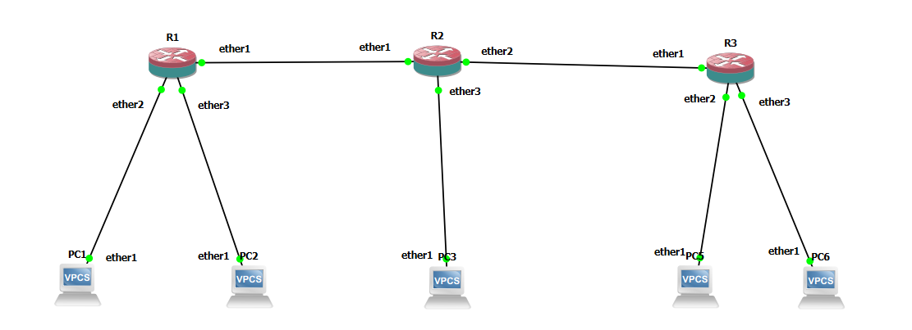
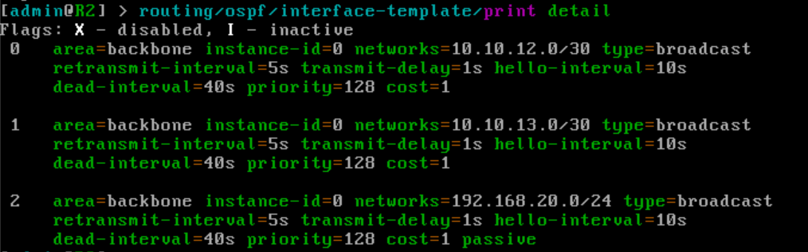
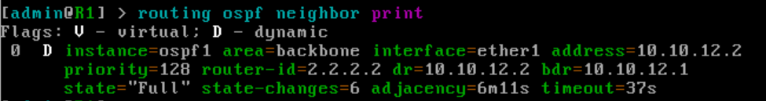
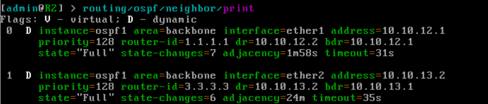
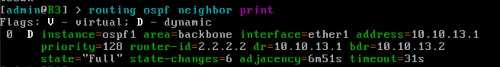
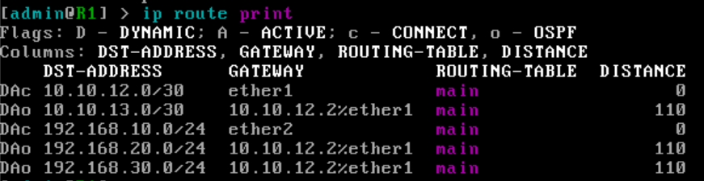
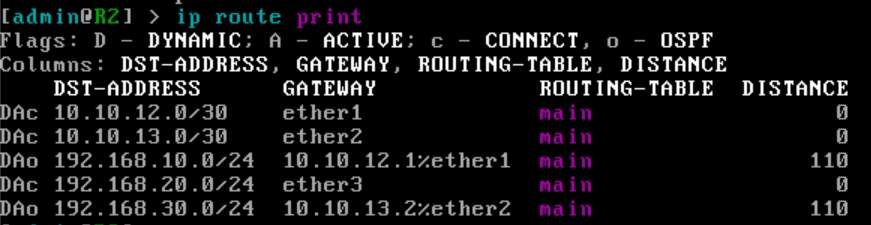
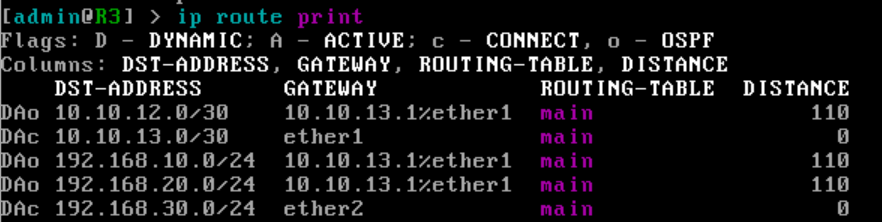
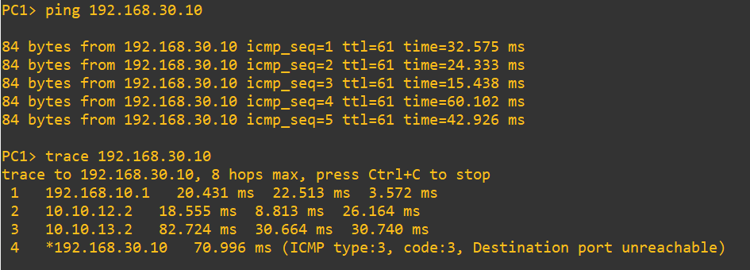
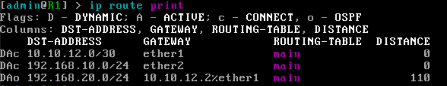

# Lab 06 — Routing Dinamis OSPF pada MikroTik (GNS3)

## 1. Tujuan

Menghubungkan tiga router MikroTik dengan OSPF (*Open Shortest Path First*) agar semua LAN saling terjangkau secara otomatis, tanpa static route manual seperti di [Lab 02](../02-ptp-static-route/README.md).

Perangkat yang dipakai: 3 router MikroTik (R1, R2, R3), 2 switch, dan 5 VPCS (PC1 sampai PC5).

> Konfigurasi dilakukan lewat console GNS3. Akses via Winbox dibahas di [Lab 04](../04-akses-winbox/README.md).

## 2. Topologi



| Dari | Ke |
| --- | --- |
| R1 `ether1` | R2 `ether1` |
| R2 `ether2` | R3 `ether1` |
| R1 `ether2` | Switch1 (PC1 dan PC2) |
| R2 `ether3` | PC3 |
| R3 `ether2` | Switch2 (PC4 dan PC5) |

R2 berada di tengah dan menjadi router transit antara R1 dan R3, sekaligus memiliki LAN sendiri.

## 3. Rencana Alamat

**Link antar router**

| Link | Network | Ujung 1 | Ujung 2 |
| --- | --- | --- | --- |
| R1 ke R2 | `10.10.12.0/30` | R1 `ether1`: `10.10.12.1/30` | R2 `ether1`: `10.10.12.2/30` |
| R2 ke R3 | `10.10.13.0/30` | R2 `ether2`: `10.10.13.1/30` | R3 `ether1`: `10.10.13.2/30` |

Satu link memakai satu network. Subnet /30 dipilih karena hanya membutuhkan dua alamat host.

**LAN dan router ID**

| Router | Interface LAN | Alamat LAN | Router ID |
| --- | --- | --- | --- |
| R1 | `ether2` | `192.168.10.1/24` | `1.1.1.1` |
| R2 | `ether3` | `192.168.20.1/24` | `2.2.2.2` |
| R3 | `ether2` | `192.168.30.1/24` | `3.3.3.3` |

**PC**

| PC | Router | Alamat | Gateway |
| --- | --- | --- | --- |
| PC1 | R1 | `192.168.10.10/24` | `192.168.10.1` |
| PC2 | R1 | `192.168.10.11/24` | `192.168.10.1` |
| PC3 | R2 | `192.168.20.10/24` | `192.168.20.1` |
| PC4 | R3 | `192.168.30.10/24` | `192.168.30.1` |
| PC5 | R3 | `192.168.30.11/24` | `192.168.30.1` |

## 4. Informasi Umum

| Item | Nilai |
| --- | --- |
| Versi GNS3 server | 2.2.61 |
| Versi RouterOS | 7.21.5 |
| Protokol routing | OSPFv2 |
| Area | `backbone` (`0.0.0.0`) |

## 5. Konsep Singkat

Pada static route, setiap jaringan di seberang harus didaftarkan manual di setiap router, dan harus diubah lagi setiap ada jaringan baru atau link yang putus. Dengan OSPF, router saling bertukar informasi jaringan secara otomatis dan menghitung jalur terbaiknya sendiri.

Istilah yang dipakai di lab ini:

- **Instance**: proses OSPF yang berjalan di router.
- **Router ID**: pengenal unik tiap router di jaringan OSPF. Bentuknya seperti alamat IP, tetapi hanya sebagai angka pengenal, dan **harus berbeda** di setiap router.
- **Area**: pengelompokan router OSPF. Lab ini hanya memakai satu area, yaitu `backbone` (`0.0.0.0`).
- **Interface template**: menentukan network mana yang ikut OSPF dan masuk area apa.
- **Passive**: ditambahkan pada network LAN. Interface tetap diumumkan ke router lain, tetapi tidak mengirim paket OSPF ke LAN karena di sana hanya ada PC.
- **Neighbor**: router tetangga yang sudah bertukar informasi. State `Full` menandakan hubungan sudah lengkap.

## 6. Konfigurasi Alamat IP

Perintah dijalankan di terminal MikroTik masing-masing router. Versi lengkap (alamat dan OSPF) ada di [`configs/r1.rsc`](configs/r1.rsc), [`configs/r2.rsc`](configs/r2.rsc), dan [`configs/r3.rsc`](configs/r3.rsc).

**R1**

```routeros
/system identity set name=R1
/ip address add address=10.10.12.1/30 interface=ether1 comment="Link ke R2"
/ip address add address=192.168.10.1/24 interface=ether2 comment="LAN PC1 dan PC2"
```

**R2**

```routeros
/system identity set name=R2
/ip address add address=10.10.12.2/30 interface=ether1 comment="Link ke R1"
/ip address add address=10.10.13.1/30 interface=ether2 comment="Link ke R3"
/ip address add address=192.168.20.1/24 interface=ether3 comment="LAN PC3"
```

R2 memiliki tiga alamat, satu per interface, karena menghadap dua router dan satu LAN.

**R3**

```routeros
/system identity set name=R3
/ip address add address=10.10.13.2/30 interface=ether1 comment="Link ke R2"
/ip address add address=192.168.30.1/24 interface=ether2 comment="LAN PC4 dan PC5"
```

**PC (VPCS)**

```
PC1> ip 192.168.10.10/24 192.168.10.1
PC2> ip 192.168.10.11/24 192.168.10.1
PC3> ip 192.168.20.10/24 192.168.20.1
PC4> ip 192.168.30.10/24 192.168.30.1
PC5> ip 192.168.30.11/24 192.168.30.1
```

Jalankan `save` di tiap PC setelah mengatur alamat.

## 7. Kondisi Sebelum OSPF

Sebelum OSPF diaktifkan, ping antar LAN yang berbeda belum berhasil, karena setiap router hanya mengenal jaringan yang menempel langsung padanya.

```
PC1> ping 192.168.30.10
```
Inilah masalah yang diselesaikan OSPF.

## 8. Konfigurasi OSPF

Urutannya sama di setiap router: instance, area, lalu interface template untuk tiap network.

**R1**

```routeros
/routing ospf instance add name=ospf1 version=2 router-id=1.1.1.1
/routing ospf area add name=backbone area-id=0.0.0.0 instance=ospf1
/routing ospf interface-template add area=backbone networks=10.10.12.0/30
/routing ospf interface-template add area=backbone networks=192.168.10.0/24 passive
```

**R2**

```routeros
/routing ospf instance add name=ospf1 version=2 router-id=2.2.2.2
/routing ospf area add name=backbone area-id=0.0.0.0 instance=ospf1
/routing ospf interface-template add area=backbone networks=10.10.12.0/30
/routing ospf interface-template add area=backbone networks=10.10.13.0/30
/routing ospf interface-template add area=backbone networks=192.168.20.0/24 passive
```

**R3**

```routeros
/routing ospf instance add name=ospf1 version=2 router-id=3.3.3.3
/routing ospf area add name=backbone area-id=0.0.0.0 instance=ospf1
/routing ospf interface-template add area=backbone networks=10.10.13.0/30
/routing ospf interface-template add area=backbone networks=192.168.30.0/24 passive
```

Yang berbeda di tiap router: `router-id` dan daftar network pada interface template. Yang sama: nama instance, versi, dan area.

Parameter network pada interface template tersimpan dengan nama `networks`. Kalau saat mengetik kamu menulis `network=`, RouterOS tetap menerimanya sebagai singkatan, dan hasilnya sama. Cek isinya dengan:

```routeros
/routing ospf interface-template print detail
```



Pada R2 terlihat tiga entri dengan `area=backbone`, dan `passive` hanya pada LAN `192.168.20.0/24`.

## 9. Verifikasi

### a. Instance dan tetangga OSPF

Di R1, R2, dan R3:

```routeros
/routing ospf instance print
/routing ospf neighbor print
```

Pastikan router ID sesuai rencana (`1.1.1.1`, `2.2.2.2`, `3.3.3.3`) dan state tetangga `Full`. R1 dan R3 masing-masing punya satu tetangga (R2), sedangkan R2 punya dua tetangga (R1 dan R3).

**R1**
ospf-ins-r1.png



**R2**




**R3**




### b. Route hasil OSPF

```routeros
/ip route print
```

Route yang dipelajari lewat OSPF ditandai flag `o` (dinamis).

| Router | Route OSPF yang diharapkan |
| --- | --- |
| R1 | `10.10.13.0/30`, `192.168.20.0/24`, `192.168.30.0/24` |
| R2 | `192.168.10.0/24`, `192.168.30.0/24` |
| R3 | `10.10.12.0/30`, `192.168.10.0/24`, `192.168.20.0/24` |

**R1**



**R2**



**R3**



### c. Ping dan trace antar PC

Dari PC1 ke PC4 (LAN di router paling ujung):

```
PC1> ping 192.168.30.10
PC1> trace 192.168.30.10
```



Ping berhasil, dan nilai `ttl=61` cocok dengan jalur yang melewati tiga router (TTL awal 64, berkurang satu di tiap router).

Hasil trace:

```
trace to 192.168.30.10, 8 hops max, press Ctrl+C to stop
 1   192.168.10.1   20.431 ms  22.513 ms  3.572 ms
 2   10.10.12.2   18.555 ms  8.813 ms  26.164 ms
 3   10.10.13.2   82.724 ms  30.664 ms  30.740 ms
 4   *192.168.30.10   70.996 ms (ICMP type:3, code:3, Destination port unreachable)
```

| Hop | Alamat | Artinya |
| --- | --- | --- |
| 1 | `192.168.10.1` | R1 (gateway PC1) |
| 2 | `10.10.12.2` | R2, lewat link ke R1 |
| 3 | `10.10.13.2` | R3, lewat link ke R2 |
| 4 | `192.168.30.10` | PC4, tujuan tercapai |

Pesan `Destination port unreachable` di hop terakhir bukan error. Trace di VPCS mengirim paket UDP ke port acak, dan PC tujuan membalas dengan ICMP *port unreachable* karena tidak ada program yang mendengarkan di port itu. Balasan tersebut justru tanda paket sudah tiba di tujuan.

## 10. Percobaan: Route Berubah Sendiri

Percobaan ini menunjukkan keunggulan OSPF dibanding static route.

1. Di R2, matikan interface menuju R3:

   ```routeros
   /interface disable ether2
   ```

2. Tunggu beberapa saat, lalu cek di R1:

   ```routeros
   /ip route print
   ```

   Route ke `192.168.30.0/24` hilang, dan ping dari PC1 ke PC4 gagal, karena link R2 ke R3 terputus.

   

3. Aktifkan kembali:

   ```routeros
   /interface enable ether2
   ```

4. Tunggu tetangga kembali `Full`, lalu cek lagi. Route ke `192.168.30.0/24` muncul kembali tanpa ada konfigurasi yang ditambahkan.

   

Pada static route, route yang sudah dihapus atau salah harus diperbaiki manual. Di sini router memperbarui tabel routenya sendiri.

## 11. Troubleshooting

| Gejala | Kemungkinan penyebab | Cek dan solusi |
| --- | --- | --- |
| Tetangga OSPF tidak muncul | Kedua ujung link berada di network berbeda | `/ip address print` di kedua router, network link harus sama |
| Tetangga OSPF tidak muncul | Interface template belum ditambahkan atau salah network | `/routing ospf interface-template print detail` |
| Tetangga OSPF tidak muncul atau tidak stabil | Router ID kembar | `/routing ospf instance print`, router ID harus unik |
| Tetangga OSPF tidak muncul | Area berbeda di kedua ujung | Pastikan keduanya memakai `area=backbone` |
| Tetangga `Full` tapi route OSPF tidak muncul | Network LAN belum didaftarkan di interface template | Tambahkan template untuk network LAN |
| Ping gagal padahal route ada | IP atau gateway PC salah | `show ip` di PC |
| Perintah menolak `networks=` atau `network=` | Beda nama parameter pada versi tertentu | Tekan Tab dua kali setelah mengetik awalan `net` untuk melihat nama yang valid |
| Router kernel panic saat booting (`IO-APIC + timer doesn't work`) | Beban GNS3 VM terlalu tinggi, kemungkinan karena KVM tidak aktif | Nyalakan router satu per satu, tutup console router yang tidak sedang dikonfigurasi, lalu Stop dan Start ulang node yang panik |

## 12. Kesimpulan

Tiga router berhasil dihubungkan dengan OSPF di area backbone. Semua LAN (`192.168.10.0/24`, `192.168.20.0/24`, `192.168.30.0/24`) saling terjangkau tanpa static route, dan jalur paket sesuai topologi. Saat link antar router diputus, route ikut hilang, dan setelah link kembali route muncul sendiri. Hal ini membedakan OSPF dari static route.
